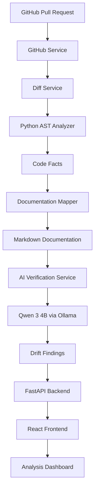

# DocGuard 🛡️
### Automated Documentation Drift Detection for GitHub Pull Requests

DocGuard is an AI-powered documentation consistency checker that identifies outdated documentation when code changes in a GitHub Pull Request.

It analyzes code changes, extracts important code facts, maps them to documentation, and uses an open-weight AI model to verify whether the documentation still accurately reflects the implementation.

**Keep your documentation synchronized with your code.**

---

## 🚨 Problem Statement

Software documentation frequently becomes outdated as developers modify functions, configurations, APIs, and application behavior.

Developers often forget to update the corresponding README files and technical documentation when submitting code changes.

This leads to:
- Incorrect instructions for developers.
- Outdated configuration values.
- Documentation that no longer matches actual code behavior.
- Additional manual effort during code reviews.

Traditional code review workflows do not consistently identify these documentation inconsistencies.

## 💡 Our Solution

DocGuard automates documentation drift detection during the Pull Request review process.

It:
1. Fetches Pull Request changes from GitHub.
2. Analyzes modified Python source files using Python AST.
3. Extracts code facts such as function signatures, configurations, classes, and CLI arguments.
4. Identifies related Markdown documentation.
5. Uses Qwen 3 (4B) through Ollama to verify documentation consistency.
6. Generates findings with severity, confidence, evidence, and suggested corrections.

The goal is to make documentation consistency an integral part of code review.

---

## ✨ Key Features

- **GitHub PR Analysis:** Analyze public GitHub Pull Requests.
- **AST-Based Code Analysis:** Extract structured information from Python source code.
- **Documentation Mapping:** Identify documentation references related to modified code symbols.
- **AI-Powered Verification:** Use Qwen 3 (4B) to evaluate whether documentation is outdated.
- **Drift Classification:** Categorize findings by severity.
- **Evidence-Based Findings:** Display documentation locations, explanations, confidence, and suggested updates.
- **Interactive Dashboard:** Review findings through a React-based frontend.
- **Audit Report Export:** Export analysis results from the dashboard.

## 🏗️ System Architecture



## 🧰 Technology Stack

| Component | Technology |
|---|---|
| Frontend | React, TypeScript, Vite |
| Styling | Tailwind CSS |
| Backend | Python, FastAPI |
| Code Analysis | Python AST |
| AI Model | Qwen 3 (4B) |
| Model Runtime | Ollama |
| GitHub Integration | GitHub REST API |
| Testing | Pytest |

## 📂 Project Structure

```text
DocGuard/
│
├── backend/
│   ├── app/
│   │   ├── api/
│   │   ├── schemas/
│   │   ├── services/
│   │   │   ├── ai_service.py
│   │   │   ├── analysis_service.py
│   │   │   ├── code_analyzer.py
│   │   │   ├── diff_service.py
│   │   │   ├── docs_mapper.py
│   │   │   └── github_service.py
│   │   ├── config.py
│   │   └── main.py
│   ├── tests/
│   ├── requirements.txt
│   └── pytest.ini
│
├── frontend/
│   ├── public/
│   ├── src/
│   │   ├── components/
│   │   ├── services/
│   │   ├── types/
│   │   └── utils/
│   ├── package.json
│   └── vite.config.ts
│
├── .gitignore
├── HACKATHON.md
└── README.md
```

## ⚙️ Installation and Setup

### Prerequisites

Install the following:

- Python 3.11 or newer.
- Node.js and npm.
- Git.
- Ollama.

### 1. Clone the repository

```bash
git clone https://github.com/Adityaharsh38/DocGuard.git
cd DocGuard
```

### 2. Set up the AI model

Install Ollama from https://ollama.com.

Download Qwen:

```bash
ollama pull qwen3:4b
```

Start Ollama if it is not already running:

```bash
ollama serve
```

Verify the model:

```bash
ollama list
```

### 3. Set up the backend

```bash
cd backend

python -m venv venv
source venv/bin/activate

pip install -r requirements.txt
```

Create a `.env` file if your configuration requires a GitHub token:

```env
GITHUB_TOKEN=your_github_token
```

Never commit your `.env` file or expose access tokens.

Start the backend:

```bash
uvicorn app.main:app --reload --host 0.0.0.0 --port 8000
```

Backend API:

```text
http://localhost:8000
```

API documentation:

```text
http://localhost:8000/docs
```

### 4. Set up the frontend

Open another terminal:

```bash
cd DocGuard/frontend

npm install
npm run dev
```

Open the frontend:

```text
http://localhost:3000
```

Use the port displayed by Vite if your configuration selects a different port.

---

## 🔌 API Endpoints

| Method | Endpoint | Purpose |
|---|---|---|
| GET | `/health` | Check backend health |
| GET | `/api/model-status` | Check AI model availability |
| POST | `/api/analyze` | Analyze a GitHub Pull Request |

### Analyze Pull Request

Request:

```json
{
  "repo_url": "https://github.com/owner/repository",
  "pr_number": 1
}
```

The analysis endpoint returns a structured report containing:

- Repository and Pull Request information.
- Total findings and severity counts.
- Documentation drift explanations.
- Evidence and suggested corrections.
- Analysis statistics.

---

## 🧪 Testing

Run backend tests:

```bash
cd backend
source venv/bin/activate
python -m pytest -v
```

The test suite covers:
- AI verification.
- Python AST analysis.
- Code comparison.
- Diff parsing.
- Documentation mapping.
- GitHub content retrieval.
- Regression and edge cases.

---

## 🎯 Example Use Case

Consider a Python project with this configuration:

```python
MAX_RETRIES = 5
```

But its README still states:

```text
MAX_RETRIES is set to 3.
```

DocGuard identifies the inconsistency and uses Qwen to verify whether the documentation is outdated.

An example finding could include:

- **Symbol:** MAX_RETRIES
- **Code value:** 5
- **Documented value:** 3
- **Severity:** High
- **Suggested correction:** Update the documentation to state that MAX_RETRIES is 5.

This helps developers identify documentation drift before merging code changes.

---

## 🔐 Responsible Usage and Current Scope

- Designed for public GitHub repositories.
- Uses static Python AST analysis rather than executing untrusted repository code.
- Uses a locally hosted open-weight model through Ollama.
- Does not automatically modify source code or documentation.
- Detection coverage depends on the supported code facts and documentation mappings implemented in the backend.

A zero-finding report does not guarantee that all documentation is correct.

---

## 👥 Team OdeX

Built during the Hack Day at Newton School of Technology, Sonipat.

| Team Member | Role |
|---|---|
| Neev Kumar | Team Lead & Frontend |
| Chhavi | Team Member |
| Aditya Harsh | Backend & AI Integration |
| Ayush Jyala | Team Member |

---

## 🚀 Vision

We envision a development workflow where documentation is treated as an essential part of every code change.

DocGuard aims to reduce documentation maintenance overhead, improve developer experience, and make software documentation more reliable.

**DocGuard — Because documentation should evolve with code.**